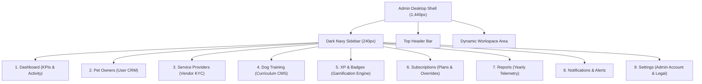
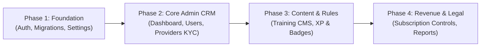

# Rivo Admin Dashboard — Figma Design Audit & API Specification Blueprint

**Figma Source**: [Figma Design Canvas — Admin Panel (node-id=1-40341)](https://www.figma.com/design/3jfXcibspzz1PqBrZdKHkb/Rivo-Design?node-id=1-40341&p=f&t=jAMTvXI1MbYTtAiw-0)  
**Layout Standards**: Desktop Web Grid (`1,440px` fixed width)  
**Target Architecture**: Laravel 11 + Spatie Permission (`role: admin`) + PostgreSQL + AtomicCache  
**Audit Date**: 2026-10-31  

---

## 1. Executive Summary & Design Shell Architecture

The **Rivo Admin Console** is a desktop web management system designed for platform administrators to monitor, manage, and moderate all platform operations.



### Navigation & Layout Anatomy
- **Left Navigation Sidebar** (`240px`, `#0B132B` / `#111827`):
  - Branding: `RIVO ADMIN CONSOLE`
  - 9 Navigation Links: **Dashboard**, **Pet Owners**, **Service Providers** (with pending counter badge), **Training**, **XP & Badges**, **Subscriptions**, **Reports**, **Notifications**, **Settings**.
  - Footer Profile: Admin Avatar `A`, `Admin User`, `admin@rivo.app`, and quick switch link `← Provider App`.
- **Top Header Bar**:
  - Breadcrumbs (`Rivo Admin > Section > Subsection`)
  - Notifications Bell with unread counter badge
  - Admin Profile Quick Pill

---

## 2. Screen-by-Screen Breakdown & UI Mapping (23 Frames)

| Module | Frame Name | Node ID | Canvas Dimensions | Key UI Elements & Controls |
| :--- | :--- | :--- | :--- | :--- |
| **0. Auth** | `Log IN` | `1-40483` | 1,440 × 966px | Email, Password, Remember Me, Forgot Password link, Sign In CTA |
| **0. Auth** | `forget password` | `1-40514` | 1,440 × 966px | Email input, Send Code CTA |
| **0. Auth** | `forget password (OTP)` | `1-40530` | 1,440 × 966px | 6-digit circular PIN inputs, Verify CTA |
| **0. Auth** | `Reset passwprd` | `1-40553` | 1,440 × 966px | Set Password, Confirm Password, Reset Password CTA |
| **0. Auth** | `Reset password success` | `1-40571` | 1,440 × 966px | Green checkmark, Confirmation message, Back to Sign In CTA |
| **1. Overview** | `dashboard` | `1-40585` | 1,440 × 1,062px | 8 Telemetry KPI Cards, Quick Actions (+Training, +Badge, +XP), 24h Activity Feed |
| **2. Pet Owners** | `pet ownwes` | `1-41507` | 1,440 × 959px | Plan filter tabs (All, Free, Plus, Pro), Search, Data Table, Pagination |
| **2. Pet Owners** | `pet owner details` | `1-41916` | 1,440 × 982px | User avatar, Plan badge, Pets list, XP & Progress chips, Badges list, Suspend User CTA |
| **3. Providers** | `Service Providers pending` | `1-42403` | 1,440 × 963px | Application cards, Category tags, Submission date, View Request CTA |
| **3. Providers** | `Provider Request` | `1-48661` | 1,440 × 963px | Full KYC Review (Owner, Email, Phone, Address, Business Registration & License PDF links), Approve / Reject CTAs |
| **3. Providers** | `service provider Approved` | `1-42644` | 1,440 × 963px | Approved vendors directory, Category, Status badges (Active/Suspended), Suspend/Reactivate |
| **3. Providers** | `Provider Details Modal` | `1-48281` | 1,440 × 963px | Vendor KYC summary, Document previews, Suspend CTA |
| **4. Training** | `Training list` | `1-42936` | 1,440 × 942px | Search, Category filter, Lessons table (Title, Category, Difficulty, Duration, XP, Status), +Add Training CTA |
| **4. Training** | `add training` | `1-44875` | 1,440 × 1,105px | Thumbnail upload, Title, Category dropdown, Difficulty, Duration, XP, Video upload, Description, Steps, Tips, Publish / Draft CTAs |
| **5. Gamification** | `XP & Badges` | `1-40904` | 1,440 × 972px | XP Rules tab (Walk: 20 XP / 50 XP; Training: 25 XP / 50 XP; Care: 10 XP / 50 XP) |
| **5. Gamification** | `XP & Badges edit (inline)` | `1-41107` | 1,440 × 972px | Inline rule input fields (Complete XP, 7-Day Streak XP), Save Changes CTA |
| **5. Gamification** | `Streak Rewards matrix` | `1-41315` | 1,440 × 972px | Activity × Milestones matrix (Walk/Training/Care × 3d/7d/30d), Inline editable cells |
| **5. Gamification** | `Badges Catalog` | `1-45346` | 1,440 × 972px | 2×3 Grid of achievement badges, +Create Badge CTA, Edit links |
| **5. Gamification** | `Create Badge` | `1-45839` | 1,440 × 972px | Icon upload, Name, Category dropdown, Requirement rule, XP reward, Save CTA |
| **5. Gamification** | `Levels Hierarchy` | `1-45586` | 1,440 × 972px | Levels 1-10 table (Pup to Legend), XP threshold, +Add Level CTA |
| **5. Gamification** | `Add level` | `1-46120` | 1,440 × 972px | Level Name, Required XP input, Add Level CTA |
| **6. Subscriptions** | `Subscription (Plans)` | `1-43295` | 1,440 × 972px | Free ($0), Plus ($9.99/mo, $89.99/yr), Pro ($19.99/mo, $149.99/yr) tier cards, Edit Price CTAs |
| **6. Subscriptions** | `edit price` | `1-44533` | 1,440 × 972px | Monthly price input, Yearly price input, Save CTA |
| **6. Subscriptions** | `Subscription (Users)` | `1-46395` | 1,440 × 972px | Active subscriber table, Status filters (All, Plus, Pro, Active, Cancelled), Manage CTA |
| **6. Subscriptions** | `Manage Subscription` | `1-46710` | 1,440 × 972px | Plan summary, Dates, Action toggles (Suspend, Extend, Revoke) |
| **6. Subscriptions** | `Extend Subscription` | `1-47072` | 1,440 × 972px | Extension period (+30d, +60d, +90d), Date picker, Reason/Note, Extend CTA |
| **6. Subscriptions** | `Reactivate Subscription`| `1-47477` | 1,440 × 972px | Remaining time notice, Resume previous or Set new expiry, Reactivate CTA |
| **6. Subscriptions** | `Revoke Subscription` | `1-47857` | 1,440 × 972px | Suspension period (Indefinite vs specific date), Reason, Admin note, Revoke CTA |
| **6. Subscriptions** | `Subscription (Payments)`| `1-44300` | 1,440 × 1,054px | Monthly revenue stat widget ($259.96), Transaction ledger table |
| **7. Reports** | `Report` | `1-43615` | 1,440 × 1,046px | Yearly filter, 3 KPIs, 12-mo User Growth area chart, 12-mo Revenue line chart, 12-mo Subscriptions bar chart, Tier segmentation bars |
| **8. Settings** | `Settings (Admin Account)`| `1-44113` | 1,440 × 1,046px | Profile card (Avatar upload, Name, Email, Save), Change Password form |
| **8. Settings** | `Settings (Legal)` | `1-43957` | 1,440 × 1,046px | Terms & Conditions rich-text editor, Privacy Policy rich-text editor |

---

## 3. Complete API Specification (32 Endpoints)

All endpoints reside under `/api/v1/admin/` and require `auth:sanctum` with `role:admin`.

### Module 1: Admin Authentication & Password Recovery
1. `POST /api/v1/admin/auth/login`
   - **Payload**: `{ "email": "admin@rivo.app", "password": "...", "remember_me": true }`
   - **Response**: `{ "token": "...", "admin": { "id": 1, "name": "Admin User", "email": "admin@rivo.app" } }`
2. `POST /api/v1/admin/auth/forgot-password`
   - **Payload**: `{ "email": "admin@rivo.app" }`
   - **Response**: `{ "success": true, "message": "Verification code sent to email" }`
3. `POST /api/v1/admin/auth/verify-otp`
   - **Payload**: `{ "email": "admin@rivo.app", "code": "123456" }`
   - **Response**: `{ "reset_token": "...", "valid": true }`
4. `POST /api/v1/admin/auth/reset-password`
   - **Payload**: `{ "reset_token": "...", "new_password": "...", "confirm_password": "..." }`
   - **Response**: `{ "success": true, "message": "Password changed successfully" }`

### Module 2: Dashboard Overview & Real-Time Telemetry
5. `GET /api/v1/admin/dashboard/stats`
   - **Query Params**: `?range=month|year`
   - **Response**:
     ```json
     {
       "total_users": 24580,
       "total_pets": 31240,
       "plus_users": 4820,
       "pro_users": 2150,
       "revenue_this_month": 84320.00,
       "revenue_histogram": [12000, 15000, 18500, 19200, 19620],
       "active_providers": 486,
       "approved_providers": 421,
       "pending_provider_requests": 12,
       "active_subscriptions": 6970,
       "subscription_trend_pct": 3.2,
       "subscription_histogram": [1300, 1380, 1410, 1430, 1450]
     }
     ```
6. `GET /api/v1/admin/dashboard/activity`
   - **Query Params**: `?limit=20&period=24h`
   - **Response**: List of recent platform audit activities with timestamps, user links, and icon tags.

### Module 3: User Management (Pet Owners)
7. `GET /api/v1/admin/users`
   - **Query Params**: `?page=1&limit=10&search=...&plan=free|plus|pro&status=active|suspended&sort=created_at`
   - **Response**: Paginated users list including pet count, computed total XP, current level, and join date.
8. `GET /api/v1/admin/users/{id}`
   - **Response**: Detailed user object with owned pets list (`id`, `name`, `type`, `avatar`), streak stats (`walk_streak`, `training_streak`, `care_streak`), and earned badges collection.
9. `POST /api/v1/admin/users/{id}/suspend`
   - **Payload**: `{ "reason": "...", "admin_note": "..." }`
10. `POST /api/v1/admin/users/{id}/reactivate`
    - **Response**: `{ "success": true, "status": "active" }`

### Module 4: Service Providers & Vendor KYC Moderation
11. `GET /api/v1/admin/providers`
    - **Query Params**: `?status=pending|approved|suspended&category=all|pet_store|veterinary|grooming&search=...`
    - **Response**: Paginated vendors with submission date, status, category, and owner name.
12. `GET /api/v1/admin/providers/{id}`
    - **Response**: Complete KYC application details including business name, type, address, contact, and array of verifiable documents (`business_registration`, `business_license`).
13. `POST /api/v1/admin/providers/{id}/approve`
    - **Response**: `{ "success": true, "status": "approved" }`
14. `POST /api/v1/admin/providers/{id}/reject`
    - **Payload**: `{ "rejection_reason": "...", "notes": "..." }`
15. `POST /api/v1/admin/providers/{id}/suspend`
    - **Payload**: `{ "reason": "...", "admin_note": "..." }`
16. `POST /api/v1/admin/providers/{id}/reactivate`
    - **Response**: `{ "success": true, "status": "approved" }`

### Module 5: Dog Training Curricula CMS
17. `GET /api/v1/admin/trainings`
    - **Query Params**: `?search=...&category=...&difficulty=beginner|intermediate|advanced&status=published|draft`
    - **Response**: Paginated training lessons with duration, XP reward, category, and status.
18. `POST /api/v1/admin/trainings` (Multipart)
    - **Payload**: `{ "title": "...", "category_id": 1, "difficulty": "beginner", "duration_minutes": 10, "xp_reward": 25, "description": "...", "steps": "...", "tips": "...", "thumbnail": File, "video": File, "status": "published" }`
19. `GET /api/v1/admin/trainings/{id}`
    - **Response**: Single lesson with step-by-step instructions, media streaming URLs, and completion stats.
20. `PUT /api/v1/admin/trainings/{id}`
    - **Payload**: Updated lesson metadata, instructions, and optional media replacements.
21. `DELETE /api/v1/admin/trainings/{id}`
    - **Response**: `{ "success": true }`

### Module 6: Gamification (XP Rules, Streak Matrix, Badges & Levels)
22. `GET /api/v1/admin/gamification/xp-rules`
    - **Response**: `{ "walk": { "complete_xp": 20, "streak_7d_xp": 50 }, "training": { "complete_xp": 25, "streak_7d_xp": 50 }, "care": { "complete_xp": 10, "streak_7d_xp": 50 } }`
23. `PUT /api/v1/admin/gamification/xp-rules/{activity}`
    - **Payload**: `{ "complete_xp": 20, "streak_7d_xp": 50 }`
24. `GET /api/v1/admin/gamification/streak-rewards`
    - **Response**: Full 3×3 matrix of activity milestones (`walk`, `training`, `care` × `3d`, `7d`, `30d`).
25. `PUT /api/v1/admin/gamification/streak-rewards`
    - **Payload**: `{ "activity": "walk", "milestone_days": 30, "xp_reward": 200 }`
26. `GET /api/v1/admin/gamification/badges`
    - **Response**: All badges catalog with criteria, category, and awarded count.
27. `POST /api/v1/admin/gamification/badges` (Multipart)
    - **Payload**: `{ "name": "Walk Starter", "category": "Walk", "requirement": "7 Day Streak", "xp_reward": 50, "icon": File }`
28. `GET /api/v1/admin/gamification/levels`
    - **Response**: Levels 1 to 10+ progression ladder (`level_number`, `name`, `required_xp`).
29. `POST /api/v1/admin/gamification/levels`
    - **Payload**: `{ "level_number": 11, "name": "Grand Master", "required_xp": 7000 }`

### Module 7: Subscriptions, Pricing & Override Engine
30. `GET /api/v1/admin/subscriptions/plans`
    - **Response**: Plan tiers (`Free`, `Plus`, `Pro`) with monthly/annual prices, limits, and feature lists.
31. `PUT /api/v1/admin/subscriptions/plans/{id}/price`
    - **Payload**: `{ "monthly_price": 9.99, "yearly_price": 89.99 }`
32. `GET /api/v1/admin/subscriptions/subscribers`
    - **Query Params**: `?status=all|plus|pro|active|cancelled&page=1&limit=10`
    - **Response**: Subscriber list with renewal dates, plan tier, amount, and current status.
33. `POST /api/v1/admin/subscriptions/subscribers/{id}/extend`
    - **Payload**: `{ "extension_days": 30, "new_expiry_date": "2026-10-21", "reason_note": "Extended for another month." }`
34. `POST /api/v1/admin/subscriptions/subscribers/{id}/reactivate`
    - **Payload**: `{ "mode": "continue_previous", "new_expiry_date": null, "admin_note": "User requested unpause" }`
35. `POST /api/v1/admin/subscriptions/subscribers/{id}/revoke`
    - **Payload**: `{ "period_type": "indefinite", "reason": "Policy violation", "admin_note": "..." }`
36. `GET /api/v1/admin/subscriptions/payments`
    - **Query Params**: `?page=1&limit=10&period=this_month`
    - **Response**: Monthly revenue total ($259.96) and transactions ledger (`id`, `user`, `plan`, `amount`, `date`).

### Module 8: Platform Reports & Analytics
37. `GET /api/v1/admin/reports`
    - **Query Params**: `?year=2026`
    - **Response**:
      ```json
      {
        "year": 2026,
        "metrics": {
          "total_users": 24580,
          "subscriptions": 6970,
          "total_revenue": 84320.00
        },
        "user_growth_monthly": [ {"month": "Jan", "count": 18000}, ..., {"month": "Dec", "count": 24580} ],
        "revenue_monthly": [ {"month": "Jan", "amount": 62000.00}, ..., {"month": "Dec", "amount": 84320.00} ],
        "subscription_growth_monthly": [ {"month": "Jan", "active": 5000}, ..., {"month": "Dec", "active": 6970} ],
        "distribution": {
          "free_users": { "count": 17610, "percentage": 71.6 },
          "rivo_plus": { "count": 4820, "percentage": 19.6 },
          "rivo_pro": { "count": 2150, "percentage": 8.7 }
        }
      }
      ```

### Module 9: Admin Settings & Legal Content
38. `GET /api/v1/admin/settings/profile`
    - **Response**: `{ "name": "Admin User", "email": "admin@rivo.app", "avatar_url": "..." }`
39. `PUT /api/v1/admin/settings/profile` (Multipart)
    - **Payload**: `{ "name": "...", "email": "...", "avatar": File }`
40. `PUT /api/v1/admin/settings/password`
    - **Payload**: `{ "current_password": "...", "new_password": "...", "confirm_password": "..." }`
41. `GET /api/v1/admin/settings/legal`
    - **Response**: `{ "terms_and_conditions": "# Terms...", "privacy_policy": "# Privacy..." }`
42. `PUT /api/v1/admin/settings/legal`
    - **Payload**: `{ "terms_and_conditions": "...", "privacy_policy": "..." }`

---

## 4. Existing Backend Models vs Admin Requirements

| Admin Requirement | Existing Backend Model / Table | What Needs to be Created |
| :--- | :--- | :--- |
| **Admin Auth** | `User` (with `spatie/laravel-permission` role `admin`) | `AdminAuthController`, Password Reset OTP notification |
| **Dashboard Metrics** | `User`, `Pet`, `Store`, `Order`, `Transaction`, `Plan` | `AdminDashboardService` with cached aggregate queries |
| **Pet Owners** | `User`, `Pet`, `PetWalkStat`, `PetTrainingStat`, `PetCareStat` | `AdminUserController` with query filters and suspend state |
| **Service Providers** | `Store`, `StoreDocument`, `User` | `AdminProviderController` (KYC review, approve/reject/suspend) |
| **Training CMS** | `TrainingLesson`, `TrainingLessonStep`, `TrainingCategory` | `AdminTrainingController` (CRUD + media uploads) |
| **XP & Streak Rules** | `WalkReward`, `PetCareStat` | `platform_settings` table / model for dynamic gamification rules |
| **Badges & Levels** | Dynamic rules in stats services | `badges` and `levels` migration, model, and seeders |
| **Subscriptions** | `Plan`, `Transaction` | `AdminSubscriptionController` with override methods (extend/revoke) |
| **Reports** | `Transaction`, `User`, `Order` | `AdminReportService` with monthly trend aggregations |
| **Legal Settings** | Not present | Key-value settings storage (`Setting::get('terms')`) |

---

## 5. Implementation Roadmap for Tomorrow



1. **Step 1: Database Foundation & Settings Table**
   - Migration for `platform_settings`, `badges`, `levels`, and user/store suspension columns (`suspended_at`, `suspension_reason`).
2. **Step 2: Admin Auth & Dashboard Telemetry**
   - Implement `AdminAuthController` and `DashboardService` with atomic caching.
3. **Step 3: User & Vendor Management**
   - Build `AdminUserController` and `AdminProviderController` with KYC verification and approval actions.
4. **Step 4: Training & Gamification CMS**
   - Build `AdminTrainingController` and gamification rule management endpoints.
5. **Step 5: Subscription Overrides & Financial Reports**
   - Implement subscription extension, reactivation, and revocation mechanics, plus yearly telemetry charts.
6. **Step 6: Bruno Collection & Automated Test Suite**
   - Generate test requests in Bruno under a new `Admin/` folder and write comprehensive Feature tests.
